# Timezones

An app for keeping track of what time it is for your friends in different parts of the world :3

Yup, it's as simple as that!

> [!IMPORTANT]
> This app requires **Android 16 or later!**

## Installation

Go to the [latest release][latest] and download the `timezones.apk` file, or directly download it
through [this link][download] :3

After downloading the APK, your browser should offer to open it directly. If Android asks you to
allow installations from your browser, enable that permission and continue with the installation :3

## Usage and Features

> [!Tip]
> This app has translations for German as well!

First of all, this app uses your phone's settings for both the date and time display formats. So
if you use the 24-hour time, it uses that, if you don't, it uses the 12-hour time, and if you use
for example `English (United States)` the dates will be formatted like `October 14, 2026` whereas
if you use `English (United Kingdom)` the dates will be formatted like `14 October 2026`, and so on
for other languages.

To get started, add a person you wanna know the timezone of. You can do so by heading to the People
tab and clicking the `+` button.

<!--suppress ALL -->
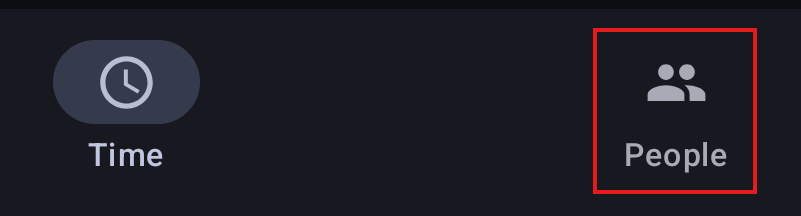

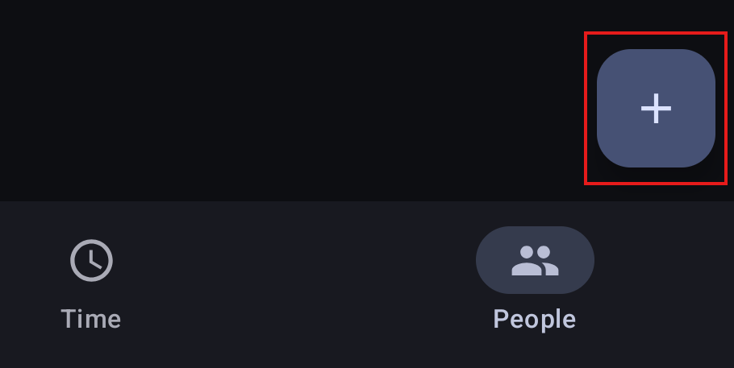

The Add Person dialog will pop up.

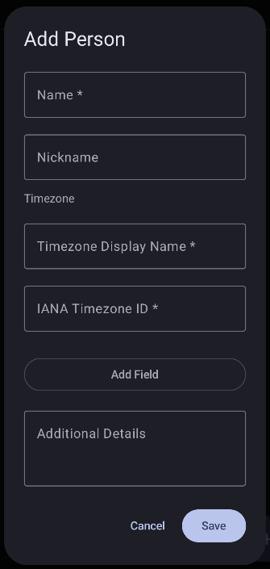

Then you can add some information about the person. Required are the name of the person, as well as
their timezone and the name you wanna give that timezone. When you select a timezone without inputting
a name for the timezone first, the name will be autofilled, e.g. if you select America/New_York,
the name will be autofilled as "New York". After you're done, hit the Save button.

> [!Note]
> Multiple people can be in the same timezone, so don't name a timezone after a person!
>
> IANA timezone IDs use underscores instead of spaces in names, like `America/New_York`. But don't
> worry, you don't need to memorize them! There's a dropdown that uses the input as a search field,
> so typing for example 'America' will show only options containing 'America' in the dropdown.

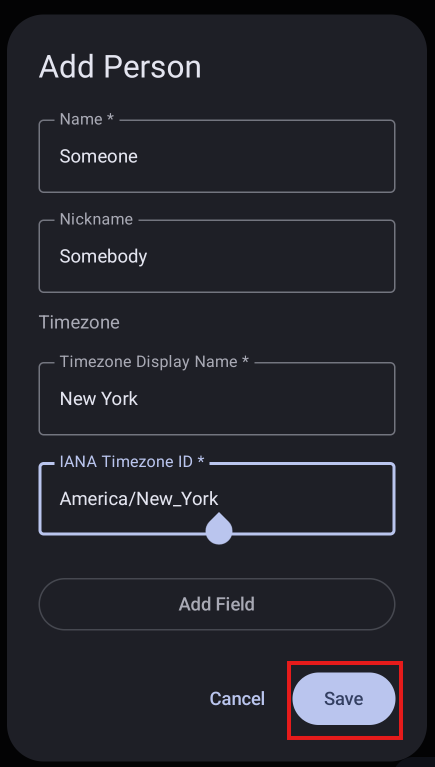

After saving, you can see the new person you just added in the People tab, as well as their current
time.

Now switch back to the Time tab.

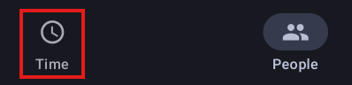

You'll now see the new timezone that you added.

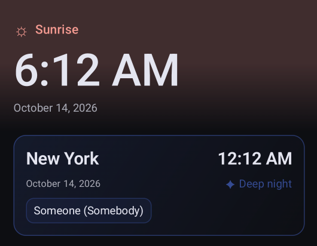

> [!Note]
> If the person you added is in the same timezone as you, this will look different!
>
> 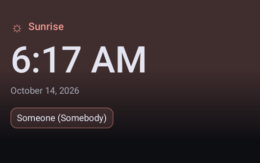

Clicking on the person in the timezone (or in your time), or clicking on the person in the People
tab, opens the details dialog. Here you can see their name, nickname, timezone, as well as any
custom information you added.

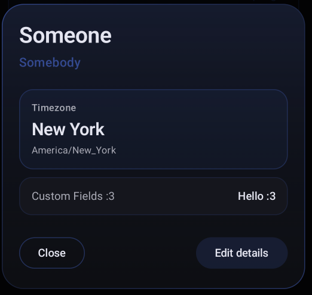

To add custom information, in the Add Person or Edit Person dialog (Press 'Edit Details' in the
Details dialog), click the "Add Field" button.

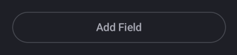

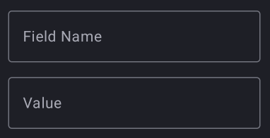

Then give the field a name and a value. Only the name is mandatory, a field without a value will be
marked with `-` as the value. This can be used to, for example, add birthdays, usernames for certain
platforms, or really anything you want! You can also use the "Remove Field" button to remove the
field again!

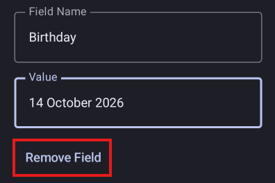

Also! Once you've added custom fields on other people, when you go to add a new person or edit an
existing person, typing the first letter into a Field Name field will trigger an autocomplete
dropdown with all the custom fields that have already been created!

In the Edit Person Dialog, you can also choose to delete a Person from the app or change the
Timezone. If there is a timezone that no people are using anymore, for example you delete the last
person that was using a timezone, or change their timezone to a different one, the unused timezone
is deleted.

You can add multiple People to the app though! And once you have one person, when you open the
Add Person dialog, the Timezone selection looks different! The first button opens a dropdown to
select a timezone that already-added people are already using, defaulting to the first (or only)
one. Clicking the "Create a new Timezone" button gives you the two text inputs again for the name
and the timezone ID, with a new button underneath to go back to choosing an existing timezone.

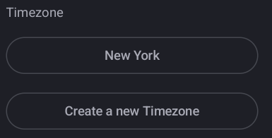

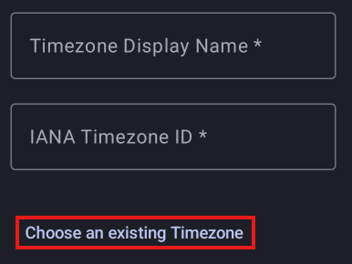

Back in the Time tab, if you click on the time of a timezone, it opens the comparison dialog!

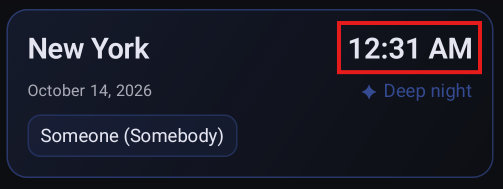

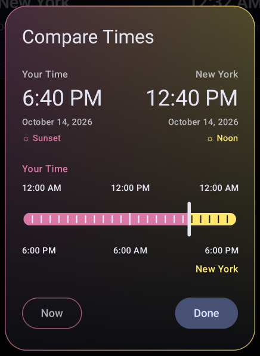

Here you can drag the slider around to compare your time to the chosen timezone's time, from
midnight at the beginning of the current day to midnight at the beginning of the next day, in
10-minute steps.

Don't like the order of the timezones? Switch to the People tab and tap the "Reorder timezones"
button!

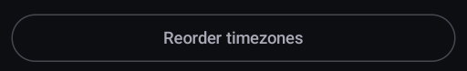

This opens the Reorder Timezones dialog, where you can change the order of them. People are always
displayed in the same order, though, alphabetically.

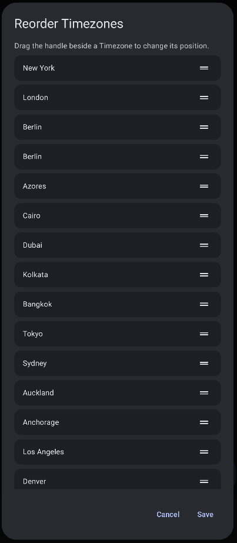

Once you're done, hit Save, or hit Cancel to undo your changes and leave them as they were! Remember
that your own timezone is always hidden!

That's all!

<!-- Link Definitions -->
[latest]: https://github.com/CatMaxiMyoga/TimezonesAndroid/releases/latest
[download]: https://github.com/CatMaxiMyoga/TimezonesAndroid/releases/latest/download/timezones.apk